# MICROVERSE Relational Database Architecture & ER Diagram

This document specifies the complete PostgreSQL schema implemented via Prisma ORM for the **MICROVERSE** educational and simulation platform.

---

## 1. Entity-Relationship (ER) Diagram

```mermaid
erDiagram
    User ||--o{ UserProgress : "tracks chapter"
    User ||--o{ LessonProgress : "tracks lesson"
    User ||--o{ QuizAttempt : "attempts"
    User ||--o{ Bookmark : "saves"
    User ||--o{ SavedExperiment : "creates"
    User ||--o{ ResearchNote : "authors"
    User ||--o{ UserBadge : "earns"
    Badge ||--o{ UserBadge : "granted via"

    Chapter ||--|{ Lesson : "contains"
    Chapter ||--o| Quiz : "assessed by"
    Chapter ||--o{ UserProgress : "recorded in"
    Chapter ||--o{ ResearchNote : "referenced by"

    Lesson ||--o{ LessonProgress : "recorded in"
    Lesson ||--o{ ResearchNote : "referenced by"

    Quiz ||--|{ QuizQuestion : "comprises"
    Quiz ||--o{ QuizAttempt : "evaluated through"

    Controller ||--o{ Bookmark : "saved as"
    Controller ||--o{ ResearchNote : "analyzed in"

    User {
        string id PK "UUID"
        string email UK "Unique engineering email"
        string passwordHash "Bcrypt hashed passphrase"
        string name "Full engineer name"
        string role "USER or ADMIN"
        string bio "Nullable engineer biography"
        string avatar "Nullable profile image URI"
        datetime createdAt "Creation timestamp"
        datetime updatedAt "Last modification timestamp"
    }

    Controller {
        string id PK "UUID"
        string name UK "Model code e.g. STM32F401RET6"
        string commonName "Friendly name e.g. Nucleo Core"
        string family "STM32, AVR, ESP32, RP2040, PIC, 8051"
        string architecture "ARMv7E-M, Xtensa, AVR 8-bit"
        string core "Cortex-M4, AVR, Xtensa LX6"
        string manufacturer "ST, Microchip, Espressif, RPi"
        int bitWidth "8, 16, or 32"
        float maxClockSpeedMHz "Clock frequency"
        float flashKb "Non-volatile storage"
        float sramKb "Static RAM"
        float eepromKb "Nullable EEPROM storage"
        float operatingVoltageMin "Minimum supply volts"
        float operatingVoltageMax "Maximum supply volts"
        string logicLevel "3.3V or 5V"
        int gpioCount "General purpose I/O count"
        int adcChannels "Analog to digital channels"
        int adcResolutionBits "ADC bit resolution"
        int dacChannels "DAC channel count"
        int timers "Hardware timer count"
        int uartCount "UART / USART count"
        int spiCount "SPI bus count"
        int i2cCount "I2C bus count"
        int canCount "CAN controller count"
        boolean usbSupport "Native USB controller"
        string wireless "WiFi / BLE details"
        boolean fpu "Floating Point Unit"
        boolean dsp "DSP instruction extension"
        int dmaChannels "DMA channel count"
        float deepSleepCurrentUa "Deep sleep microamperes"
        string packageTypes "LQFP, QFN, DIP"
        string description "Overview text"
        string architecturalNotes "Internal bus & memory notes"
        string datasheetUrl "Manufacturer datasheet link"
        string pinoutDiagram "Pinout graphic link"
        json specifications "Flexible register maps & memory map"
        json pinoutConfig "Interactive pin multiplexing map"
        boolean isFeatured "Flag for featured carousel"
        datetime createdAt "Timestamp"
        datetime updatedAt "Timestamp"
    }

    Chapter {
        string id PK "UUID"
        int chapterNumber UK "Sequence order e.g. 1..8"
        string title "Chapter designation"
        string slug UK "URL friendly identifier"
        string summary "High-level overview"
        string level "BEGINNER, INTERMEDIATE, ADVANCED"
        int estimatedMinutes "Estimated completion time"
        string content "Markdown instructional body"
        string keyTakeaways "Key points array"
        boolean isPublished "Publishing visibility flag"
        datetime createdAt "Timestamp"
        datetime updatedAt "Timestamp"
    }

    Lesson {
        string id PK "UUID"
        string chapterId FK "References Chapter(id)"
        int lessonNumber "Sub-sequence within chapter"
        string title "Lesson title"
        string slug UK "URL slug"
        string summary "Summary"
        string content "Markdown lesson content"
        int estimatedMinutes "Duration"
        int order "Display order"
        boolean isPublished "Visibility flag"
        datetime createdAt "Timestamp"
        datetime updatedAt "Timestamp"
    }

    LessonProgress {
        string id PK "UUID"
        string userId FK "References User(id)"
        string lessonId FK "References Lesson(id)"
        boolean isCompleted "Completion state"
        datetime completedAt "Nullable completion date"
        datetime lastAccessedAt "Last accessed timestamp"
    }

    UserProgress {
        string id PK "UUID"
        string userId FK "References User(id)"
        string chapterId FK "References Chapter(id)"
        boolean isCompleted "Completion state"
        datetime completedAt "Nullable completion date"
        datetime lastAccessedAt "Last accessed timestamp"
    }

    Quiz {
        string id PK "UUID"
        string chapterId FK "References Chapter(id) [1:1]"
        string title "Assessment title"
        string description "Assessment instructions"
        int passingScore "Percentage threshold e.g. 70"
        datetime createdAt "Timestamp"
        datetime updatedAt "Timestamp"
    }

    QuizQuestion {
        string id PK "UUID"
        string quizId FK "References Quiz(id)"
        string question "Prompt question text"
        string codeSnippet "Nullable C / Assembly snippet"
        string options "JSON array of choice options"
        int correctOptionIndex "0-based index of correct option"
        string explanation "Engineering explanation"
        int points "Points weight e.g. 10"
        datetime createdAt "Timestamp"
    }

    QuizAttempt {
        string id PK "UUID"
        string userId FK "References User(id)"
        string quizId FK "References Quiz(id)"
        int score "Points earned"
        int totalPoints "Total available points"
        boolean passed "Pass / Fail boolean"
        string answers "JSON record of submitted choices"
        datetime attemptedAt "Attempt timestamp"
    }

    Bookmark {
        string id PK "UUID"
        string userId FK "References User(id)"
        string itemType "CONTROLLER, CHAPTER, LESSON, EXPERIMENT"
        string itemId "UUID of the saved target"
        string controllerId FK "Nullable relation to Controller(id)"
        datetime createdAt "Timestamp"
    }

    SavedExperiment {
        string id PK "UUID"
        string userId FK "References User(id)"
        string title "Simulation name"
        string description "Nullable notes"
        string experimentType "GPIO, PWM, PROTOCOL, PID, BREADBOARD"
        string configState "Serialized simulation parameters"
        json schematicData "Breadboard wiring & component topology"
        datetime createdAt "Timestamp"
        datetime updatedAt "Timestamp"
    }

    ResearchNote {
        string id PK "UUID"
        string userId FK "References User(id)"
        string title "Note heading"
        string content "Markdown engineering notes"
        string category "ARCHITECTURE, PERIPHERAL, PROTOCOL, EXPERIMENT, ROBOTICS, GENERAL"
        string tags "Nullable comma-separated tag list"
        string controllerId FK "Nullable reference to Controller(id)"
        string chapterId FK "Nullable reference to Chapter(id)"
        string lessonId FK "Nullable reference to Lesson(id)"
        boolean isPublic "Public visibility toggle"
        datetime createdAt "Timestamp"
        datetime updatedAt "Timestamp"
    }

    Badge {
        string id PK "UUID"
        string code UK "Unique badge identifier e.g. FIRST_EXPERIMENT"
        string title "Badge name"
        string description "Unlock criteria description"
        string icon "Lucide icon key"
        string category "Laboratory, Knowledge, Firmware"
    }

    UserBadge {
        string id PK "UUID"
        string userId FK "References User(id)"
        string badgeId FK "References Badge(id)"
        datetime unlockedAt "Timestamp"
    }
```

---

## 2. Relational Integrity & Key Constraints

1. **Composite Uniqueness:**
   - `UserProgress`: `@@unique([userId, chapterId])` prevents duplicate progress entries for the same chapter.
   - `LessonProgress`: `@@unique([userId, lessonId])` enforces single tracking row per user/lesson.
   - `Bookmark`: `@@unique([userId, itemType, itemId])` prevents duplicate bookmarks.
   - `UserBadge`: `@@unique([userId, badgeId])` ensures badges can only be unlocked once per user.

2. **Foreign Key Cascade Policies:**
   - `onDelete: Cascade` on `UserProgress`, `LessonProgress`, `QuizAttempt`, `Bookmark`, `SavedExperiment`, and `ResearchNote` ensures clean data removal when a user account is deleted.
   - `onDelete: Cascade` on `Lesson` and `Quiz` when parent `Chapter` is deleted.
   - `onDelete: SetNull` on `ResearchNote.controllerId` and `ResearchNote.chapterId` preserves user notes even if a controller or chapter is retired.

3. **Performance Indexing Strategy:**
   - **Filter Indexes:** `Controller(family)`, `Controller(architecture)`, `Controller(bitWidth)`, `Controller(isFeatured)`.
   - **User Foreign Key Indexes:** `UserProgress(userId)`, `LessonProgress(userId)`, `QuizAttempt(userId)`, `Bookmark(userId)`, `SavedExperiment(userId)`, `ResearchNote(userId)`.
   - **Slug Lookups:** `Chapter(slug)`, `Lesson(slug)`.
   - **Chronological Sorting:** `ResearchNote(createdAt)`, `SavedExperiment(createdAt)`, `QuizAttempt(attemptedAt)`.

4. **Strategic JSON Fields:**
   - `Controller.specifications`: Houses flexible vendor-specific register maps, memory banking layouts, and power operating states without fragmenting into dozens of sparse columns.
   - `Controller.pinoutConfig`: Houses interactive pin multiplexing maps (alternate functions, timer channels, analog inputs) for the interactive pinout visualizer.
   - `SavedExperiment.schematicData`: Houses dynamic breadboard wiring topologies, probe points, and simulator nodes.
   - All relational entities (Users, Controllers, Lessons, Quizzes, Questions, Attempts, Progress, Notes) remain strictly normalized.

